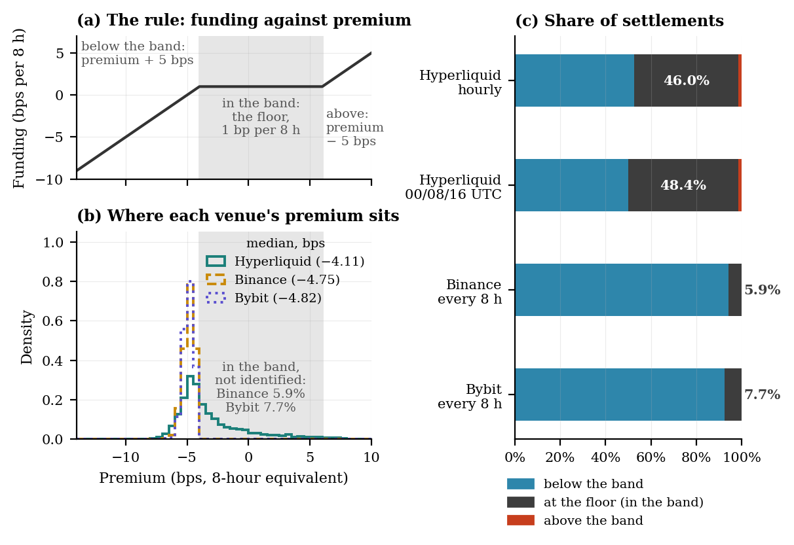

# HMM in Decentralised Perpetual Futures

Replication package for the working paper

> **Same Formula, Different Signal: Funding-Rate Censoring and the Premium Gap
> between Hyperliquid and Centralised Perpetuals**
> Gregor Albiez, School of Business, FHNW Basel.

Working paper, October 2026 (SSRN link to follow) · PDF:
[`paper/paper.pdf`](paper/paper.pdf) · LaTeX source: [`paper/paper.tex`](paper/paper.tex)

> Hyperliquid, Binance and Bybit set perpetual funding by one rule: while the
> averaged premium lies in a 10 bp band, funding equals an interest rate of
> 0.01% per eight hours, and a settlement reveals the premium only as that band.
> From 2 October 2025 to 28 April 2026, 46.0% of Hyperliquid's hourly BTC
> settlements sit at that rate, against 5.9% on Binance and 7.7% on Bybit. From
> 11 December 2023 to 30 September 2026 the shares are 55.2%, 23.8% and 27.3%
> for BTC and 52.0%, 23.1% and 28.3% for ETH; taken together, the two quarters
> in which the exchanges' premiums were positive reverse the ordering. Matched
> hour by hour with the exchanges' own premium indices, Hyperliquid's BTC
> premium lies a median 2.2 bps above both (ETH 1.7), in four hours out of five
> and in every quarter. For BTC the gap persists but varies: 3.8 bps in 2024,
> 3.0 to 3.1 in 2025, 0.3 to 0.5 in 2026Q1 and 2026Q2 and 1.3 to 1.5 in 2026Q3.
> By a Shapley split it accounts for about all of the difference in shares from
> 2024Q3 to 2025Q4, but for less than half in 2026Q1 and 2026Q2 (ETH: 55% to
> 70%), when all three median premiums lay below the band and dispersion
> mattered more. Cross-venue comparisons of positioning should therefore use
> premiums, with their constructions in view, not headline rates. A two-state
> Markov-switching AR(1) on the premium reverts faster under stress only around
> October 2025: allowing for switching, the half-life ratio is 1.5, not
> significantly different from one under a misspecification-robust covariance
> that one hour of the 10 October crash dominates, and later data reverse it. A
> three-state Gaussian hidden Markov model separates hourly volatility into
> 14.6%, 33.3% and 88.4% annualised states and estimates the direct move from
> the high to the low state at zero to three decimals, as do its fits to
> simulated single-regime Student-t GARCH paths. All results are descriptive.



*Figure 2 of the paper: (a) the funding rule, flat at the interest rate while the
averaged premium lies inside the band; (b) where each venue's premium sits
against that band; (c) the share of settlements below the band, exactly at the
floor and above it.*

**The comparison.** `censoring.py` counts, per venue and window, the funding
settlements exactly at the floor, from the venues' own decimal prints;
`longhistory.py` extends the count to BTC and ETH from Hyperliquid's first
record, classifies its rule history record by record and orders the venues'
premiums block by block; `premium_gap.py` matches the three premiums hour by
hour and splits the difference in floor shares into location, averaging and
dispersion.

**The two models.** A **Markov-switching AR(1)** on Hyperliquid's premium, via
`statsmodels`, with Hessian, OPG and sandwich covariances and the Wald test that
decides the side of unity; and a **Gaussian HMM (K=3)** on hourly log-returns,
estimated with a self-contained log-space Forward–Backward / Baum–Welch
implementation, with a profile-likelihood bound on its boundary transition.

**The code**, in `src/regime_engine/`: `censoring.py`, `longhistory.py` and
`premium_gap.py` (the cross-venue comparison), `fetch_cex.py` and
`fetch_premium.py` (the Binance and Bybit series), `hmm.py` (Gaussian HMM and
the MS-AR multi-start), `hmm_batch.py` (batched Baum–Welch and the fit
protocol), `msar.py` (MS-AR inference, half-lives under switching),
`msar_tables.py` (the MS-AR tables), `a31.py` (inference on a transition
probability at the boundary), `analysis.py` (pipeline, figures, tables),
`diagnostics.py` (bootstrap, residual tests, benchmarks), `robustness.py`
(winsorisation, K = 2 … 5), `oos.py` (rolling windows, single-observation
sensitivity), `fetch_official.py` and `fetch_prices.py` (Hyperliquid data
retrieval and checks), `fetch_data_legacy.py` (the live fetch behind
`analysis --fetch`), `funding.py` (the clamp arithmetic), `panel.py`
(alignment without look-ahead), `paper_figures.py` (the explanatory figures,
each from a tested data function), `paths.py` (repository paths).

---

## Read this before you re-run anything

### 1. The series replicate differently, and one of them only partly

| Series | Status |
|---|---|
| **Funding rate and premium** | **Fully replicable.** `fundingHistory` has no retention limit: it is free, unauthenticated, serves BTC and ETH back to May 2023, and returns any window on demand. The estimation-window series ships here (`data/interim/premium_BTC_full.csv`, 8,737 contiguous hours) *and* can be re-fetched; re-fetched on 19 Aug 2026 it agreed with the archived panel **bit-for-bit on all 3,507 overlapping hours**. The long histories (`data/longhistory/`) and the premium-gap series (`data/premium_gap/`) are re-fetchable the same way. |
| **Binance and Bybit funding and premium** | **Fully replicable.** Public, unauthenticated endpoints. Shipped in `data/interim/` for the estimation and later windows (per venue, 1,096 eight-hourly settlements and 8,761 hourly premium-index readings, stamped from 1 Oct 2025 00:00 to 1 Oct 2026 00:00 UTC), in `data/longhistory/` (the settlements of BTCUSDT and ETHUSDT since 2019 and 2020) and in `data/premium_gap/` (one-minute premium-index klines aggregated to Hyperliquid's hours, settlements and hourly prices, from 11 Dec 2023). |
| **Prices** | **Partly replicable.** `candleSnapshot` serves only the most recent ~5,000 candles **per sampling interval**, so its reach is `5000 × interval`: about 208 days at **1h**, which is why the 2 Oct – 2 Dec 2025 segment is gone at hourly frequency; about 417 days at **2h**, which covers the estimation window in full until 22 November 2026, and about 833 days at **4h**, which covers it until January 2028. The candles are built from traded prices, not from the mark price. |

So every funding-side number in the paper — every censoring, premium-gap and
MS-AR result — reproduces from source, by anyone with an internet connection
and no account. The **hourly** return panel for Oct–Nov 2025 does not. What
ships for the return side is `data/processed/panel_BTC_subsample.csv` — 3,507
hourly rows, 3 Dec 2025 to 28 Apr 2026 — plus two-hourly candles covering the
whole estimation window, which match the hourly panel aggregated to two hours on
all 1,753 overlapping bars. The estimation-window return fit (Table 7, Figure 8 and the
volatilities quoted from it) rests on the original 28 April 2026 extract and is
**not** re-derivable at hourly frequency; Table 2's log-return row, Tables C3,
C6 and C7 and Figures C1 and C2 use the sub-period.

`output/summary_FULLSAMPLE_2025-10-02_to_2026-04-28.json` preserves the
original estimation-window fitted parameters verbatim. It is the only surviving
record of the T = 5,001 hourly fit and is never regenerated. Two things to know
before reading it. Its arrays are ordered by **mu ascending**, the labelling
this package used at the time, so index 0 is the high-volatility state — the
opposite end from every artifact written since. And its `funding_MSAR` block is
the **superseded** MS-AR optimum (logL −4828.67, half-lives 42.87 h and 1.75 h;
the archived fit stopped a little short of the converged point of the same
optimum, which `output/msar_optima.json` gives as 42.89 h and 1.74 h); the
estimate the paper stands behind is in `output/diagnostics.json`, under the
MS-AR block whose window is the paper window. The estimation-window K = 2 fit
that version 1.2.0 printed was never archived as JSON; it survives only in that
version's `paper/tables/table1_model_selection.tex` (commit a747459).

### 2. The MS-AR likelihood is multi-modal and its dominant optimum is not its maximum

On the paper's window the premium likelihood shows two optima. Running
`regime_engine.hmm.fit_ms_ar1_multistart` at its defaults (40 starts, seed base
20260802, `search_reps=40`) finds:

| logL | starts reaching it | half-life, calm | half-life, stressed | ratio calm/stressed |
|---|---|---|---|---|
| **−4808.53** (the maximum) | 16 / 40 | 35.55 h | 3.18 h | **11.2** |
| −4828.67 (the attractor) | 24 / 40 | 42.89 h | 1.74 h | 24.6 |

The inferior optimum is 20.14 log-likelihood points worse and is reached by
**60% of starts**; across six disjoint blocks of 40 seeds it attracts 20 to 30
of the 40 (`output/msar_seed_variation.json`). Because the half-life is a steep
transform of `phi`, that gap more than doubles the headline ratio. A single fit
converges cleanly, reports no warning, and is wrong three times in five. The
paper reports **11.2** with the Wald test of φ_calm = φ_stressed, which decides
the side of unity (z = 3.71 with the Hessian, 1.01 with the sandwich
covariance), and Section 6.1 shows that most of its size comes from one hour of
the 10 October 2025 crash and that the sandwich covariance supports what remains
only once October's upper tail is capped (the upper 1% winsorised, or its October
hours alone).

- **Never trust a single-start MS-AR fit on this data.** Use
  `fit_ms_ar1_multistart` and inspect the `optima_found` diagnostic it returns.
- **`msar.fit_msar_premium` runs the multi-start protocol by default**
  (`n_starts=40`), and `regime_engine.analysis` calls it that way, so the
  shipped entry point is safe on either window. On the shipped Dec–Apr
  sub-sample no start finds a second optimum: 36 of 40 starts reach logL
  −2689.90, and the other four stop with a numerical error.

---

## Every table and figure, and the command that rebuilds it

Printed numbers differ from file names; the map below gives both. The paper
`\input`s `paper/tables/` and `paper/figures/`, which hold only what it prints.
A generated table there is an identical copy of the one its command writes to
`output/tables/`; three tables are kept by hand from archived fits.
`tests/test_manuscript_structure.py` checks both, and
`tests/test_manuscript_numbers.py` checks every number the abstract and
Sections 2 to 8 print against the artifact it comes from. All commands run
offline from the repository root with `export PYTHONPATH=src`.

| Printed | File | Content | Command | Numbers in |
|---|---|---|---|---|
| Table 1 | `table13_construction.tex` | how each venue builds the premium | `python3 -m regime_engine.premium_gap` | the venues' documentation; notes a and c from `output/censoring_long_history.json` and `output/premium_gap.json` |
| Table 2 | in `paper.tex` | summary statistics | — | `output/censoring_comparison.json` (descriptives), `output/summary.json` (log-return row) |
| Table 3, Figure 2 | `table10_censoring_venues.tex`, `fig4_censoring_venues.pdf` | censoring on three venues, estimation and later windows | `python3 -m regime_engine.censoring` | `output/censoring_comparison.json` |
| Table 4, Figure 3 | `table11_long_history.tex`, `fig10_long_history.pdf` | censoring and the order of the premiums since December 2023, BTC and ETH | `python3 -m regime_engine.longhistory` | `output/censoring_long_history.json` |
| Table 5, Figure 4; Tables C1, C2 | `table12_premium_gap.tex`, `fig11_premium_gap.pdf`; `table12b_*`, `table12c_*` | the premium gap and its Shapley split | `python3 -m regime_engine.premium_gap` | `output/premium_gap.json` |
| Table 6; Tables C4, C5 | `table3b_funding_robust.tex`; `table8b_*`, `table9b_*` | the MS-AR on the premium; rolling windows; upper-tail sensitivity | `python3 -m regime_engine.msar_tables` | `output/diagnostics.json`, `output/oos_robustness.json` |
| Table 7 | `table2_regime_params.tex` (by hand) | the K = 3 return model, estimation window | — (archived fit); errors from `make bootstrap` | `summary_FULLSAMPLE_*.json`, `output/bootstrap_hmm.json` |
| Table C3 | `table6_diagnostics.tex` (by hand) | residual diagnostics | `make diagnostics` | `output/diagnostics.json` |
| Table C6 | `table5_robustness.tex` (by hand) | winsorisation | `make robustness` | `output/robustness.json` |
| Table C7 | `table7_benchmarks.tex` | out-of-family benchmarks | `make benchmarks` | `output/benchmarks.json` |
| Figures 1, 5, 6, 7, 8 | `fig5_windows.pdf`, `fig7b_october_hour_robust.pdf`, `fig8b_rolling_robust.pdf`, `fig9_optima.pdf`, `fig6_transitions.pdf` | windows and data; the October hour; rolling windows; two optima; transition geometry (kernel reconstructed from the archived diagonal and stationary distribution, Â31 = 0 imposed) | `python3 -m regime_engine.paper_figures` | the artifacts above, `output/msar_optima.json`, `output/a31_evidence.json` |
| Figures C1, C2 | `fig2_distributions.pdf`, `fig1_regime_dashboard.pdf` | the sub-period fit: distributions and dashboard | `make analyse` | `output/summary.json` |

`make diagnostics` and `python3 -m regime_engine.oos` write the MS-AR records
that `msar_tables` reads. `oos` also writes the linear-interval tables of
version 1.2.0 (`table8_rolling.tex`, `table9_sensitivity.tex`), and
`paper_figures` the matching figures (`fig7_october_hour`, `fig8_rolling`), to
`output/` only.

Six further results in the text of Section 6 come from the side scripts in
`scripts/`. The MS-AR fitted to the headline rate comes from
`scripts/msar_on_rate.py` (`output/msar_on_rate.json`);
the two-hourly refit over the whole estimation window (11.0%, 31.7% and 88.9% annualised)
from `scripts/two_hourly_refit.py` (`output/two_hourly_refit.json`); the
comparison of K = 2 … 5 from `scripts/model_selection_extended.py`
(`output/model_selection_extended.json`); the seed blocks from
`scripts/msar_seed_variation.py` (`output/msar_seed_variation.json`); what each
optimum implies from `scripts/msar_optima.py` (`output/msar_optima.json`); and
the profile-likelihood bound on the high-to-low transition, its calibration,
its power and the GARCH simulations from `scripts/a31_evidence.py`
(`output/a31_evidence.json`). Other numbers printed only in the text come from
the artifacts in the map, for example the single-regime AR(1) half-life
(`output/premium_gap.json`, `hyperliquid_premium_ar1`) and the October-only and
from-11-October upper-tail fits (`output/oos_robustness.json`, `upper_tail`);
`tests/test_manuscript_numbers.py` names the file and key of each.

---

## Reproducing

Python 3.9.6 with the pinned packages; no installation of this repository
itself, and no network access except for the `--fetch` steps.

```bash
git clone https://github.com/gelatotrade/HMM-Decentralised-Perpetual-Futures
cd HMM-Decentralised-Perpetual-Futures
git checkout v1.3.0                            # the version the paper cites
python3 -m pip install -r requirements.txt     # exact pins; skip if already satisfied
export PYTHONPATH=src                          # src layout — no install needed

python3 -m pytest tests/ -q                                    # all green
python3 -m regime_engine.fetch_official --self-test            # offline, no network
python3 -m regime_engine.fetch_prices  --self-test             # offline, no network
python3 -m regime_engine.fetch_cex     --self-test             # offline, no network
python3 -m regime_engine.censoring                             # Table 3 and Figure 2
python3 -m regime_engine.longhistory                           # Table 4 and Figure 3
python3 -m regime_engine.premium_gap                           # Tables 1, 5, C1, C2, Figure 4
python3 -m regime_engine.msar_tables                           # Tables 6, C4, C5
python3 -m regime_engine.paper_figures                         # Figures 1, 5, 6, 7, 8
python3 -m regime_engine.analysis \
    --panel data/processed/panel_BTC_subsample.csv --out output/
python3 -m regime_engine.robustness \
    --panel data/processed/panel_BTC_subsample.csv --out output/
python3 scripts/a31_evidence.py --part profile                 # one block of a31_evidence.json
```

The Makefile wraps them: `make censoring`, `make longhistory`,
`make premiumgap`, `make msartables`, `make figures`, `make analyse`,
`make robustness`, `make diagnostics`, `make benchmarks`, `make bootstrap`,
`make oos`, `make a31` and `make test`. One bootstrap block reruns through the
module, which keeps the others:
`python3 -m regime_engine.diagnostics --bootstrap --bootstrap-blocks sub_sample`.
The offline rebuilds of `censoring`, `longhistory`, `premium_gap`, `msar_tables`
and `paper_figures` return the shipped files byte for byte on macOS/arm64.

Run times on that machine:

| Step | Time |
|---|---|
| `censoring`, `longhistory`, `msar_tables`, `paper_figures` (offline) | a few seconds each |
| `premium_gap` (offline: artifact with its bootstrap, tables, figure) | about 15 seconds |
| `analysis` and `robustness` on the shipped panel | a few minutes between them |
| `make benchmarks` | well under a minute |
| `make diagnostics` | about three minutes |
| `make bootstrap` | about 35 minutes |
| `make oos` (`python3 -m regime_engine.oos`) | about 20 minutes |
| `scripts/msar_optima.py`, `msar_on_rate.py`, `two_hourly_refit.py` | under a minute each |
| `scripts/msar_seed_variation.py` | about ten minutes |
| `scripts/model_selection_extended.py` | about 9 minutes |
| `scripts/a31_evidence.py --part profile` | about nine minutes; it keeps the `calibrated` sub-block only while the bound and its calibration are unchanged, else rerun `--part profile_calibrated` (about 40 minutes) |
| `scripts/a31_evidence.py` with 8 jobs | about two hours; `--part garch` alone about 32 minutes |
| `python3 -m regime_engine.longhistory --fetch` | about 7 minutes |
| `python3 -m regime_engine.premium_gap --fetch` | about an hour (one-minute klines from December 2023) |
| the test suite | about 7 minutes |

### What those commands reproduce

Values on the shipped 3,507-hour sub-sample, byte-identical to the archived
`output/robustness.json`, and equal to `output/summary.json` on every reported
figure:

| Quantity | Value |
|---|---|
| K=3 HMM log-likelihood | 14 323.8437 |
| K=3 HMM BIC | −28 533.41 |
| ΔBIC (K=3 − K=2) | −176.59 |
| Clamp share (funding on the 0.125 bps/h floor) | 35.44% (1,243 / 3,507) |
| MS-AR half-life, calm / stressed | 7.12 h / 24.84 h |

These are **sub-sample** numbers and they are not the paper's headline figures.
The paper reports the estimation window: T = 5,001, a 46.0% share at the floor,
and the half-life ratio of 11.2. On the Dec–Apr sub-sample the ordering of the
half-lives **reverses** — the stressed regime is the more persistent one —
because the stressed premium regime is driven by the October 2025 excursion
(premium max +23.6132 bps at 2025-10-10 22:00 UTC), which the sub-sample does
not contain.

### Reproducing the paper's funding-side result

This needs the full premium series, which ships in `data/interim/`. Runs in
about two minutes.

```bash
export PYTHONPATH=src
python3 - <<'PY'
import numpy as np, pandas as pd
from regime_engine.hmm import fit_ms_ar1_multistart

df = pd.read_csv("data/interim/premium_BTC_full.csv", parse_dates=["time"])
df = df[(df["time"] >= "2025-10-02") & (df["time"] <= "2026-04-28 08:00:00+00:00")]
y = df["premium"].to_numpy(float) * 1e4          # premium in bps; T = 5001

_, res, seed, diag = fit_ms_ar1_multistart(y, n_starts=40)
names = list(res.model.param_names)
p = dict(zip(names, np.asarray(res.params, float)))
phi = [p[n] for n in names if n.startswith("ar.L1")]
s2  = [p[n] for n in names if n.startswith("sigma2")]
calm, stressed = np.argsort(s2)                  # calm = low variance
hl = lambda k: np.log(0.5) / np.log(abs(phi[k]))
print(f"logL {res.llf:.2f}   calm {hl(calm):.2f} h   stressed {hl(stressed):.2f} h"
      f"   ratio {hl(calm)/hl(stressed):.2f}")
PY
```

Expected output:

```
[MS-AR] multi-start: 2 distinct optima over 40 starts (0 failures)
         logL     -4828.67  x 24
         logL     -4808.53  x 16  <-- reported (max)
[MS-AR] WARNING: the most frequent optimum is NOT the maximum. ...
logL -4808.53   calm 35.55 h   stressed 3.18 h   ratio 11.19
```

---

## Data sources

Hyperliquid's data come from its public info endpoint
(`POST https://api.hyperliquid.xyz/info`), free and without an account. Series
align on an hourly UTC grid: candles and funding are inner-joined on the hour,
funding is never forward-filled, and the return at `t` uses only the closes at
`t` and `t − 1` (`regime_engine.panel.build_hourly_panel`).

- **`fundingHistory`** — `{"type": "fundingHistory", "coin": "BTC", "startTime": ms, "endTime": ms}`
  returns `time`, `fundingRate` (per hour since 8 June 2023, per eight hours
  before) and `premium` (8-hour-equivalent), at most 500 records per call.
  Re-fetch to a scratch path, never over the shipped file, and compare:

  ```bash
  python3 -m regime_engine.fetch_official --start 2025-10-02 --end 2026-10-01 \
      --out /tmp/premium_refetch.csv
  python3 -c "import pandas as pd; a = pd.read_csv('data/interim/premium_BTC_full.csv', dtype=str); \
  b = pd.read_csv('/tmp/premium_refetch.csv', dtype=str); print(a.equals(b.head(len(a))))"
  python3 -m regime_engine.fetch_official --validate     # against the archived panel
  ```

  `--end` is an inclusive day, so a fetch today returns a strict superset of the
  shipped hours, and the comparison prints `True`: every shipped row comes back
  unchanged. That is why the file is tracked in git.
- **`candleSnapshot`** — `{"type": "candleSnapshot", "req": {"coin": "BTC", "interval": "2h", "startTime": ms, "endTime": ms}}`
  returns OHLCV candles of traded prices, about 5,000 per interval:

  ```bash
  python3 -m regime_engine.fetch_prices --dry-run --start 2025-10-02 --end 2025-12-02   # retention and deadlines
  python3 -m regime_engine.fetch_prices --source candles --interval 2h \
      --start 2025-10-02 --end 2025-12-02
  python3 -m regime_engine.fetch_prices --validate     # bit-exact against the panel
  ```

- **Binance and Bybit** — the BTCUSDT and ETHUSDT perpetuals' funding histories
  (`fapi/v1/fundingRate`; `v5/market/funding/history`) and premium index
  (`fapi/v1/premiumIndexKlines`; `v5/market/premium-index-price-kline`), with
  Binance's hourly futures klines (`fapi/v1/klines`) and USDCUSDT spot klines
  (`api/v3/klines`), all public. Both settle at 00, 08 and 16 UTC under the
  same clamp-and-floor rule. Rates are kept as the venues' decimal strings, so
  "at the floor" is exact. The estimation and later windows:

  ```bash
  python3 -m regime_engine.fetch_cex --start 2025-10-01 --end "2026-10-01 00:00" \
      --out /tmp/cex_refetch
  for f in /tmp/cex_refetch/*.csv; do cmp "$f" "data/interim/$(basename "$f")" && echo "same: $f"; done
  ```

  The same `--end` reproduces the shipped files byte for byte. The long
  histories and the premium-gap series, BTC and ETH on all three venues:

  ```bash
  python3 -m regime_engine.longhistory --fetch           # data/longhistory, then rebuild
  python3 -m regime_engine.fetch_premium --raw-dir DIR   # data/premium_gap, keeping the klines
  python3 -m regime_engine.fetch_premium --from-raw DIR  # rebuild the hourly files offline
  ```

---

## What ships

```
paper/                                   manuscript, PDF, and only the tables and figures it inputs
data/processed/panel_BTC_subsample.csv   3,507 hourly rows, 3 Dec 2025 – 28 Apr 2026
                                         (time, OHLCV, fundingRate, premium, log_return,
                                         funding_bps)
data/processed/panel_BTC_extended.csv    the same panel continued hourly to 27 Aug 2026
data/interim/premium_BTC_full.csv        8,737 contiguous hours of funding rate +
                                         premium, stamped 2 Oct 2025 00:00 – 1 Oct 2026 00:00 UTC
data/interim/prices_BTC_2h_*.csv         two-hourly OHLCV covering the estimation window
data/interim/{binance,bybit}_BTCUSDT_*.csv  Binance and Bybit funding (eight-hourly) and
                                         hourly premium index, stamped 1 Oct 2025 00:00 –
                                         1 Oct 2026 00:00 UTC
data/longhistory/                        funding of BTC and ETH on the three venues, as the
                                         venues print it: Hyperliquid from 12 May 2023,
                                         Binance from 2019, Bybit from 2020, to 1 Oct 2026
data/premium_gap/                        11 Dec 2023 – 1 Oct 2026: Hyperliquid's hourly funding
                                         and premium, the exchanges' one-minute premium-index
                                         klines aggregated to its hours, their settlements,
                                         hourly prices and USDCUSDT spot
output/*.json                            every fitted number behind the paper
output/summary_FULLSAMPLE_*.json         the original estimation-window fit — never regenerated
output/tables/, output/figures/          what the code regenerates; the generated tables
                                         the paper inputs are identical copies
src/regime_engine/                       the estimation code
scripts/                                 the scripts behind model_selection_extended.json,
                                         msar_seed_variation.json, msar_optima.json,
                                         msar_on_rate.json, two_hourly_refit.json and
                                         a31_evidence.json, and compare_artifacts.py
tests/                                   unit tests, ground-truth recovery, manuscript guards
```

`data/raw/` and `output/cache/` are gitignored: the first is large and
regenerable, the second is a content-addressed fit cache keyed on a SHA-256 of
the panel and of the estimator's source and hyperparameters, so neither a
changed panel nor changed code can return a stale fit.

---

## Environment, seeds, determinism

Developed and run on **CPython 3.9.6** (macOS system Python, Darwin 24.5.0,
arm64). `requirements.txt` pins the exact versions every archived number was
produced with:

```
numpy 2.0.2   scipy 1.13.1   pandas 2.3.3   statsmodels 0.14.6   matplotlib 3.9.4
```

`statsmodels` is the pin that matters. Its Markov-switching start-parameter
search has changed across 0.14.x point releases, so an MS-AR result is not
checkable without naming the version.

| Fit | Seed |
|---|---|
| Return HMM, K states | `42 + K` (45 for K = 3), 8 random starts, each run until the log-likelihood gains less than 1e-6 (cap 100,000); the first start with the largest log-likelihood continued until \|ΔlogL\| < 1e-9 and no parameter moves more than 1e-10. The archived estimation-window fit (`summary_FULLSAMPLE_*`) stopped at 150 iterations |
| Model selection, K = 2…5 | `45 + K` for the 40 default starts, `20261009 + K` for 160 starts with spread volatilities, plus 3 splits of each state of the best K − 1 fit: 203–212 starts per K (`scripts/model_selection_extended.py`) |
| Robustness HMM | `45`, same restarts |
| MS-AR start search | `20260802` (`hmm.MSAR_SEED`) |
| MS-AR multi-start | seed base `20260802`, seeds `20260802 … 20260841` |
| MS-AR seed blocks | seed bases `20260802 + 40·j`, j = 0 … 5 |
| Premium-gap bootstrap | `20261008`, 2,000 replicates of one-week (168-hour) blocks |
| Switching-adjusted intervals | `20261009`, 50,000 draws |

The MS-AR seed seeds NumPy's **legacy global** RNG, because that is what
`statsmodels`' start-parameter search draws from; the fit saves and restores the
caller's RNG state around it. Left unseeded, the log-likelihood moves between
runs and one run raised `LinAlgError`.

Results are reproducible on the same platform. They are *not* expected to be
bit-identical across architectures — a different BLAS will differ in the last
bits — so treat the archived JSON as the macOS/arm64 reference, not as a
cross-platform hash. `ruff check src/ tests/ scripts/` is clean, and
`.github/workflows/ci.yml` runs ruff and the test suite on Linux/x86-64 as a
smoke test.

---

## Licence and citation

The **MIT License** (`LICENSE`), © 2026 Gregor Albiez, covers the replication
code and its machine-readable outputs: `src/`, `scripts/`, `tests/`, the
Makefile and CI configuration, this README, and the JSON files and LaTeX tables
under `output/`.

**The paper is not covered by that licence.** Everything under `paper/`
(`paper.tex`, `paper.pdf`, its tables and figures) and the figure files under
`output/figures/` remain © 2026 Gregor Albiez, all rights reserved, pending the
terms of wherever the paper is published. Cite it; do not redistribute it as
your own.

The data under `data/` were retrieved from the public APIs of Hyperliquid,
Binance and Bybit and are redistributed here for replication only; no claim is
made over them.

`CITATION.cff` drives GitHub's "Cite this repository" box. It cites the working
paper and will carry the SSRN link and DOI once the paper is posted.

## Contact

Gregor Albiez — `gregor.albiez@students.fhnw.ch`

## Use of AI tools

AI assistants (Claude, Anthropic) supported this project: in searching the
literature, in writing and testing code, in cross-checking results and in
drafting and editing the text. The research question, the design of the study
and the interpretation of the results are the author's; the author directed the
work, reviewed its results and takes full responsibility for the paper and this
repository.
